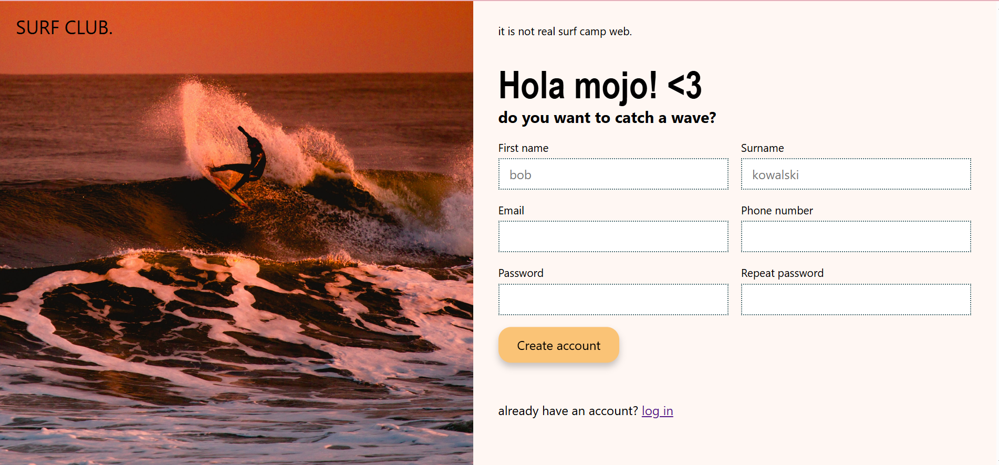

# Surf Club Sign-Up Form

A sign-up page for a fictional surf club, built with HTML and CSS as part of [The Odin Project](https://www.theodinproject.com/) curriculum.

> This is a demo project, not a real surf camp website.

## Features

- Two-column layout built with Flexbox: a full-height photo on one side, the form on the other
- Club name displayed over the photo on a semi-transparent banner, using absolute positioning
- Form fields arranged in two columns with `flex-wrap` and `calc()`
- Built-in HTML form validation (`required`, `minlength`, input types like `email` and `tel`)
- Clear field states: highlighted border and shadow on `:focus`, red border on `:user-invalid`
- A gentle "floating on water" animation on the submit button, made with `@keyframes`
- Fluid heading size with `clamp()` and a consistent type scale stored in CSS custom properties

## Built with

- HTML
- CSS

## What I learned

- Structuring a page with semantic HTML before adding any styles
- Building layouts with Flexbox, and why flex items sometimes need `min-width: 0`
- Making an image fill its container without distortion using `object-fit: cover`
- Styling form states with `:focus` and `:user-invalid`
- Using CSS custom properties to keep sizes, spacing and colors consistent
- Checking text contrast in Chrome DevTools
